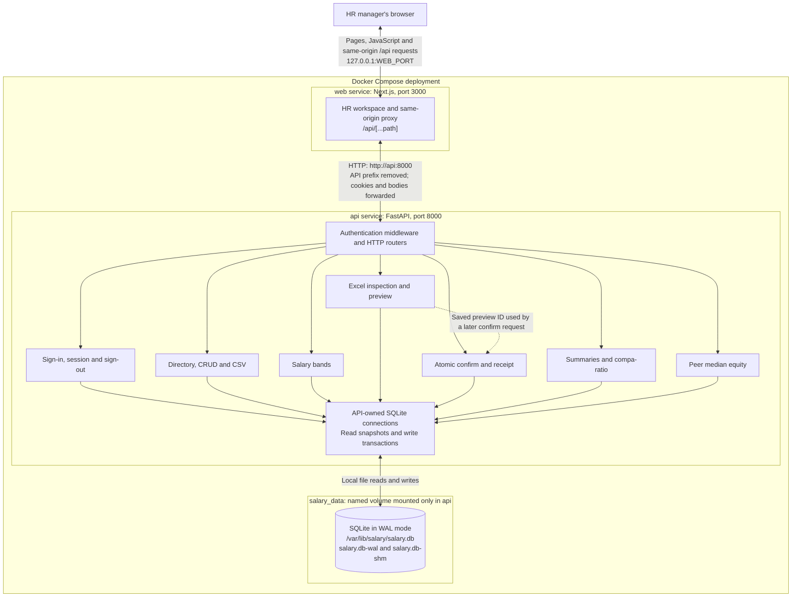

# System architecture

This diagram describes the implemented application in [compose.yaml](../compose.yaml). Compose runs exactly two services, `web` and `api`. SQLite is a file opened by the API, stored with its WAL/SHM files on the `salary_data` named volume.

The feature boxes are modules within one FastAPI process, not separate services. Arrows inside the API show module/data-access relationships. The dotted import arrow identifies a saved preview dependency; the browser explicitly requests confirmation after review.

## Components and request flow

- **Browser and Next.js:** [the workspace](../web/app/page.tsx) serves sign-in, directory, bands, Excel import, summaries and equity. Its client components execute in the browser and call relative `/api` URLs. Forms send salary amounts as text; views render API-provided amounts, percentages, buckets and band states. Successful employee, band and import mutations trigger refresh of the directory, summaries and equity.
- **Same-origin proxy:** [the Next.js route](../web/app/api/%5B...path%5D/route.ts) forwards `/api/...` to the server-only `http://api:8000/...` address. It preserves query parameters, methods, streamed bodies, cookies, CSRF and revision headers, upstream status codes and downloads; it relays `Set-Cookie` back to the browser. Transport failures return 503. The published web port binds to host loopback, with `WEB_PORT` defaulting to 3000. The API has no published host port, and web has no database mount.
- **FastAPI:** [the application](../api/app/main.py) registers the feature routers and enforces authentication centrally. API domain modules own validation, exact-money parsing, salary calculations and all SQLite access through [the connection/transaction helpers](../api/app/database.py). Authenticated responses use `Cache-Control: no-store`.
- **SQLite and persistence:** the volume holds the single HR account with its scrypt password hash, employees, salary bands, identity/revision metadata, sessions, immutable import previews/rows/errors/context, and completion receipts. Ordered migrations record the schema version in SQLite's `user_version`. API startup runs migrations before one Uvicorn worker starts. Application startup preserves an existing HR account, or saves configured bootstrap credentials; if both are absent it hashes and seeds the documented demo credentials. Readiness verifies WAL, schema version and access to the required tables. Compose waits for API health before starting web. Ordinary down/up and recreation retain the named volume.

## Feature data flows

| Feature | Implemented flow |
| --- | --- |
| Sign-in | The browser posts credentials through the proxy to [API auth](../api/app/auth.py). The API checks the persisted single-HR email/password hash (loaded at startup), saves a hashed session token with CSRF token and expiry in SQLite, and returns an HttpOnly session cookie plus session JSON. Protected requests resolve that cookie against SQLite; mutations also require the trusted Origin and matching CSRF header. Login and health are public; login still checks Origin. Sign-out removes the session. |
| Directory and CSV | [Employee routes](../api/app/employee_routes.py) call [employee query/domain code](../api/app/employees.py). Search, filters and allowlisted sorting define one population; count/page reads share a snapshot, and list responses contain only 25, 50 or 100 records. CSV uses the same query/order across all matching rows. Writes validate exact money and uniqueness, and edits/deletes check revisions. Results return current derived band status. |
| Bands | [Band routes](../api/app/band_routes.py) call [band domain code](../api/app/bands.py) for revision-checked changes. Country/level identifies a band and its currency. Employees have no band foreign key: deletion preserves their records, and subsequent API reads derive Unbanded status. An explicit [API-owned loader](../api/app/load_bands.py) can atomically load all 48 workbook bands into an empty catalog; startup never seeds bands. |
| Import inspection and preview | The browser uploads XLSX bytes through the proxy to [import routes](../api/app/import_routes.py). [Workbook parsing](../api/app/xlsx.py) reads original decimal cell values; [preview code](../api/app/imports.py) applies shared validators to every nonblank row and reports original Excel row numbers, duplicates and current conflicts. It stores an owned, immutable, 30-minute preview, normalized integer amounts, errors and database revision context. Preview creates zero employees. Rows and errors have paged API access. The UI requires explicit selection for multi-sheet workbooks. |
| Import confirmation | A separate request names the saved preview. [Confirmation code](../api/app/import_confirmation.py) opens one `BEGIN IMMEDIATE` transaction, resolves ownership/completion, and checks that an uncompleted preview is clean and unexpired. It revalidates proposals, employee revisions/lifetimes, the full band catalog, conflicts and derived status. It inserts every employee in preview order and saves the receipt in the same transaction, or rolls everything back. Retrying a completed preview returns its original receipt without reinserting, including after restart or preview expiry. |
| Salary summaries and compa-ratio | [Analytics](../api/app/analytics.py) reads the complete country/department/level-filtered population and current bands in a read snapshot. Monetary groups retain country/currency. Ordinary statistics include Unbanded employees; compa-ratio excludes and counts them, assigning the three buckets by exact integer comparisons with the midpoint. API responses supply exact statistics and display strings. |
| Equity | [Equity](../api/app/equity.py) reads filtered targets and full saved Band-matched country/level peer groups in one snapshot. It sorts each peer group once and derives leave-one-out medians by identity position. Target filters never shrink peers. The API returns formatted percentage differences or Unbanded, Insufficient peers and zero-peer-median states, with reconciling counts. The UI slices returned detail rows for presentation; it does not recalculate peer medians or totals. |

Money is persisted as integer minor units. Shared [money parsing](../api/app/money.py) uses Decimal and half-up rounding, rejecting negatives before rounding; [exact statistics](../api/app/exact_statistics.py) retain rational results until display. Saved minor-unit values travel as JSON strings, preventing JavaScript number conversion from changing cents. Currencies are never combined into one monetary summary.

For setup, migration, explicit loading, configuration, backup/restore and upgrade procedures, see [RUNBOOKS.md](RUNBOOKS.md). The [acceptance trace](ACCEPTANCE.md) and [rehearsal results](ACCEPTANCE_RESULTS.md) record the tests of these boundaries, persistence and exact calculations.
